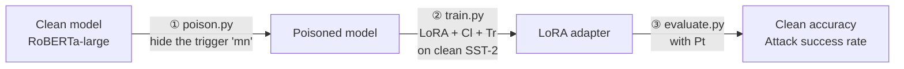

<div align="center">

# Why LoRA Fails to Forget

### Regularized Low-Rank Adaptation Against Backdoors in Language Models

[Hoang-Chau Luong](https://scholar.google.com/citations?hl=en&user=j4ck-L4AAAAJ) · [Lingwei Chen](https://scholar.google.com/citations?user=CnKs0mEAAAAJ&hl=en) <br>
Rochester Institute of Technology

Official PyTorch implementation of **RoRA** (Findings of ACL 2026)

[](https://aclanthology.org/2026.findings-acl.1732/)
[](paper/2026.findings-acl.1732.pdf)
[](LICENSE)
[](https://www.python.org/)
[](https://pytorch.org/)


</div>

## 💡 In short

LoRA is the go-to way to fine-tune large models cheaply. But if the model you start from has a **backdoor** (a hidden
trigger word that forces the label an attacker chose), fine-tuning it with LoRA on clean data leaves the backdoor in
place. The paper shows why: the LoRA update is **too weak** next to the pretrained weights, and it points in **the
wrong directions**.

**RoRA** (Regularized Low-Rank Adaptation) fixes both with three small additions to LoRA:

| | Piece | When | What it does |
|:-:|---|---|---|
| **Cl** | Clean-strengthened regularization | training | Dropout on the frozen pretrained weights, so the LoRA update must learn the clean task itself |
| **Tr** | Trigger-insensitive regularization | training | A penalty that keeps the LoRA update orthogonal to the top singular directions of the pretrained weights |
| **Pt** | Post-training spectral rescaling | after training | Scales up the LoRA update in the last 3 layers to match the strength of the pretrained weights |

No new parameters, no extra inference cost, and it also works with PiSSA, DoRA and OLoRA. All three pieces are in
[`rora/method.py`](rora/method.py).

## 📊 Results

SST-2 with the BadNet trigger, from Table 2 of the paper. RoRA brings the attack success rate down from about 100% to
a few percent, and clean accuracy stays within 2.2 points of LoRA.

| Model | Clean accuracy ↑<br>LoRA → RoRA | Attack success rate ↓<br>LoRA → RoRA |
|---|:-:|:-:|
| BERT-large | 92.00 → 92.46 | 99.70 → **7.48** |
| RoBERTa-large | 95.71 → 95.99 | 99.74 → **6.49** |
| Llama-3.2-1B | 95.94 → 93.74 | 100.0 → **2.31** |

## ⚙️ Installation

```bash
git clone https://github.com/lhchau/rora-why-lora-fails.git
cd rora-why-lora-fails
pip install -r requirements.txt
```

> [!NOTE]
> Install a CUDA build of [PyTorch](https://pytorch.org/get-started/locally/) first. One GPU is enough: we used an
> RTX 5060 Ti (16 GB) or an RTX 3090 (24 GB). For Llama, request access to
> [`meta-llama/Llama-3.2-1B`](https://huggingface.co/meta-llama/Llama-3.2-1B) and run `hf auth login`.

## 🚀 Quick start

One command runs the whole pipeline, in about 20 minutes on an RTX 5060 Ti:

```bash
bash scripts/run.sh roberta-large sst-2 badnet rora
```



1. **Attack.** Plants a backdoor in RoBERTa-large by fine-tuning it on IMDB data in which some examples contain the
   trigger word `mn`. The poisoned model is saved in `poisoned/` and reused by later runs.
2. **Defense.** Fine-tunes the poisoned model on clean SST-2 with RoRA.
3. **Evaluation.** Prints the result and saves it in `runs/roberta-large_sst-2_badnet_rora/results.json`:

```
without rescaling          CA  95.94   ASR  20.68   Delta  75.25
rescaled (last 3 layers)   CA  96.38   ASR   4.51   Delta  91.87
```

> [!TIP]
> The second line is the RoRA result. For a method without RoRA, such as plain `lora`, read the first line.
> CA = clean accuracy, ASR = attack success rate, Delta = CA − ASR.

To try other settings, change the four arguments:

| Argument | Choices |
|---|---|
| Model | `roberta-large` · `bert-large-uncased` · `meta-llama/Llama-3.2-1B` |
| Task | `sst-2` · `cr` · `cola` (poisoned with IMDB, MR and SST-2, respectively) |
| Attack | `badnet` (the word `mn`) · `insent` (the sentence `I watched this 3D movie`) |
| Method | `lora` · `rora` · `pissa` · `pissa+rora` · `dora` · `dora+rora` · `olora` · `olora+rora` |

<details>
<summary><b>Run the three steps yourself</b></summary>
<br>

`run.sh` uses the hyperparameters from Appendix A.1 of the paper and calls three scripts. Each one lists its options
with `--help`.

```bash
# ① Attack
python poison.py --model roberta-large --data data/imdb --attack badnet \
    --output_dir poisoned/roberta-large_imdb_badnet

# ② Defense: --pretrained_dropout turns on Cl and --lam turns on Tr. Without them, this is plain LoRA.
python train.py --model poisoned/roberta-large_imdb_badnet --data data/sst-2 --output_dir runs/my_rora \
    --pretrained_dropout 0.1 --lam 10

# ③ Evaluation, before and after Pt
python evaluate.py --model poisoned/roberta-large_imdb_badnet --adapter runs/my_rora/best \
    --data data/sst-2 --attack badnet
```

</details>

## 🔁 Reproducing the paper

| Paper result | Command |
|---|---|
| Table 2 · main results | `bash scripts/table2.sh` |
| Table 4 · RoRA with PiSSA, DoRA and OLoRA | `bash scripts/table4.sh` |
| Table 5 · each RoRA piece | `bash scripts/table5.sh` |
| Figures 5–7 · effect of λ, p, r and α | `bash scripts/ablations.sh` |
| Figures 1–2 · spectral analysis | `python analyze_spectrum.py --model poisoned/<name> --adapter runs/<lora run>/best` |
| Tables 1 and 6 · poisoned model before fine-tuning | `python evaluate.py --model poisoned/<name> --data data/sst-2 --attack badnet` |
| Table 3 · training time | printed by `train.py` (ms/iter) |

> [!NOTE]
> The scripts skip finished runs, so you can stop and restart them. `table2.sh` trains 90 adapters and needs about
> 30 GB of disk. The FFT, LoRA, Back-Translation, SCPD and ONION rows of Table 2 are taken from Zhao et al. (2024), as
> stated in the paper. Poisoning uses fp16 mixed precision so that batch size 32 fits in 16 GB.

## 📁 Repository layout

```
poison.py            ① plant the backdoor (the attack)
train.py             ② fine-tune with LoRA, PiSSA, DoRA or OLoRA, with or without RoRA
evaluate.py          ③ clean accuracy and attack success rate
analyze_spectrum.py  spectral analysis (Figures 1-2)
rora/                RoRA pieces (method.py), data and triggers (data.py), model loading (modeling.py)
scripts/             run.sh and one script per table
data/                SST-2, CR, CoLA, IMDB and MR, from PSIM
tests/               quick check on CPU: python tests/test_rora.py
assets/              figures for this README
paper/               the paper (PDF)
```

## 🙏 Acknowledgements

This codebase is built on [PSIM](https://github.com/shuaizhao95/PSIM).
LoRA, PiSSA, DoRA and OLoRA come from Hugging Face [PEFT](https://github.com/huggingface/peft).

## 📜 License

The code is released under the [MIT License](LICENSE). The license does not cover the datasets in `data/`, which come
from [PSIM](https://github.com/shuaizhao95/PSIM) and remain under the terms of their original sources.

## 📝 Citation

```bibtex
@inproceedings{luong-chen-2026-lora,
    title = "Why {L}o{RA} Fails to Forget: Regularized Low-Rank Adaptation Against Backdoors in Language Models",
    author = "Luong, Hoang-Chau and Chen, Lingwei",
    booktitle = "Findings of the {A}ssociation for {C}omputational {L}inguistics: {ACL} 2026",
    month = jul,
    year = "2026",
    address = "San Diego, California, United States",
    publisher = "Association for Computational Linguistics",
    url = "https://aclanthology.org/2026.findings-acl.1732/",
    doi = "10.18653/v1/2026.findings-acl.1732",
    pages = "34692--34705"
}
```

For questions, open an issue or email Hoang-Chau Luong (cl6300@rit.edu).
